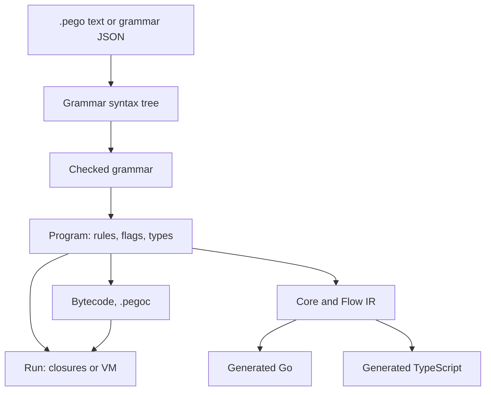
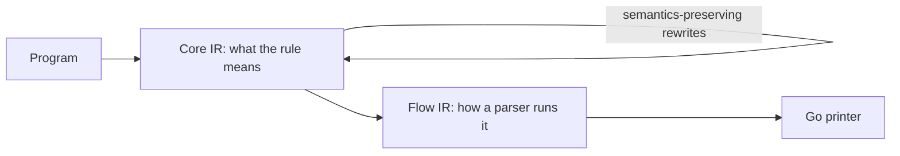

# Architecture

This page explains how PEGO turns a grammar into a parser, at the level of ideas: which stages exist, why they are
separate, and which rules hold across packages. It does not list files, fields or functions; the code is the source of
truth for those, and the package comments say what each package owns. Read this page to learn how the parts fit before
you work in `internal/compile/`, `internal/engine/`, `runtime/` or a generator. The contracts every stage must keep are
in the [specification](../../spec/README.md); the middle of the pipeline is in
[Core and Flow IR](intermediate-representations.md).

## From Grammar to Parser

A grammar passes through a few stages, and each stage answers one question that the next stage can then take as
settled.

- **Syntax tree.** Text and JSON are two spellings of one tree, so every tool (formatter, linter, language server,
  generators) works on the same structure and neither spelling is privileged. The tree says what the author wrote and
  nothing else.
- **Checked grammar.** Validation, type checking and the analyses (what calls what, what can match empty input, which
  rules can recurse on the left, what shape each value has) run once, over the whole grammar. Later stages rely on
  their answers instead of recomputing them, so a fact has one definition.
- **Program.** Compilation decides how each rule runs: whether it is memoized, whether it leads a left-recursive
  cycle, whether it builds a value or only recognizes. A `Program` is complete enough to run on its own.
- **Backends.** Executing a program and emitting code from it are separate jobs that share the stages above, not the
  implementation of the matcher.

Keeping the stages apart is what allows a new tool to enter at the right depth: a linter needs only the tree, a
generator needs the checked and compiled forms, and a runtime needs only a program.

## Why There Are Several Backends

The same grammar must behave the same way everywhere, but different uses need different trade-offs.

| Backend | Reason it exists |
|:--|:--|
| Closures | The reference: the simplest correct reading of the grammar, used by default and as the oracle for the others |
| Bytecode VMs | A compact, serializable program that runs without the grammar; the iterative VM keeps deep input off the host stack |
| Compiled grammar files | Ship a program without its source; a loaded program runs on a VM |
| Generated Go | Speed and a typed API: the grammar becomes ordinary Go code over a small runtime |
| Generated TypeScript | The same parsers in browsers and Node |

The reference backend is also a test tool. Differential tests run the same input through several backends and compare
values, errors, expectations and positions, so an optimization is correct when the backends cannot be told apart.

## Two Levels of Optimization

Generated Go is where most of the optimization work happens, and it is organized in layers so that a rewrite is
written once and verified once.

Core IR describes what each rule consumes, expects, captures and can fail with. Flow IR describes how that runs as
variables, blocks and loops. Optimizations that depend only on the meaning of the grammar are rewrites of Core IR;
the choice of loops and branches is made when lowering to Flow IR. The reasoning and the contracts are in
[Core and Flow IR](intermediate-representations.md). Only some backends use these representations today, so a Core IR
change does not by itself change every backend; [record 062](records/062-backend-independent-optimization-ir.md)
states the intended reach.

## Values, Documents and Streams

These three mechanisms change how the engine treats input and results, so they cut across the stages.

- **Values.** A rule either builds a value or only recognizes. The compile stage decides which, per rule, so that a
  recognizing path pays nothing for values it would discard. Typed output is the same decision made with the
  grammar's declared types.
- **Documents.** A Document keeps the input and the memo tables between edits, so after a change only the rules whose
  examined range was touched run again. This requires that every rule call keep exact accounting of what it read; a
  Document therefore parses on the path that keeps that accounting, while a one-shot parse may skip it where nothing
  can observe the difference.
- **Streams.** A stream commits the elements of a top-level repetition and drops the input behind them, so memory
  follows the unconsumed input rather than the whole input. This is why a stream is allowed only where nothing later
  can need what was dropped.

## Observability

Tracing, profiling, explanations and work limits are not afterthoughts bolted on at run time; every backend that can
run a program also has a way to report what it did. The design rule is that the cost when observation is off must be
a single predictable check, and that observation never changes what the parser accepts or returns. Generated code gets
the same features through variants of the generated text, so the plain build stays free of them. The user-facing
contract is [Observability](../../spec/runtime/observability.md).

## Invariants That Cut Across Packages

- **One behavior.** Every backend returns the same value, the same error and the same expectations at the same
  position for the same grammar and input. A backend that cannot meet this says so (the closure backend alone supports
  `#missing`) instead of approximating.
- **Specification first.** The specification states the contract; the engine, the runtime and the generators
  implement it. A behavior that only one of them has is a defect or a documented limit.
- **Generated code mirrors the engine.** The Go runtime used by generated parsers must match the engine's behavior,
  and tests compare them. Names that generated code calls are not a public API.
- **Analyses are shared.** Facts such as nullability and first terminals have one implementation that the compiler, the
  linter and the optimizer all use.
- **Positions and units.** Input is measured in one chosen unit (code points or bytes) everywhere a position,
  expectation or edit is reported.
- **Not stable before release.** Compiled files, JSON forms and bytecode may change between versions; there are no
  compatibility shims.

## Where to Look

| To work on | Start in |
|:--|:--|
| Grammar syntax, text and JSON forms | `internal/syntax/`, `grammar/` |
| Compilation, analysis, checking and the bytecode compiler | `internal/compile/` |
| The parser runtime: compilation entry points, streams and work controls, over the backends and the Document | `internal/engine/` |
| The parse state that every backend shares, and what a backend provides | `internal/engine/core/` |
| The closure backend | `internal/engine/closure/` |
| The bytecode VMs, recursive and iterative | `internal/engine/vm/` |
| The incremental Document, its snapshots and change reports | `internal/engine/document/` |
| Output schemas and structural queries | `schema/` (the types, their validation and `Compare`), `internal/schema/` (the export), `query/` (the queries) |
| Core and Flow IR and their passes | `internal/ir/core/`, `internal/ir/flow/` |
| Generated Go and TypeScript | The Go generator in `internal/gen/gogen/`, the TypeScript generator in `internal/gen/tsgen/` and the runtimes in `runtime/` and `internal/gen/tsgen/tsrt/` |
| The public API | `pego.go`, `grammar/` |
| Commands, linter, language server | `cmd/pego/`, `lint/`, `internal/lsp/` |
| Playground and site | `cmd/playground/`, `site/` |

## Related Topics

- [Core and Flow IR](intermediate-representations.md): the representations of the generated-Go route.
- [Design records](records/): decisions and their alternatives.
- [Development](../development.md): repository layout, tests and checks.
- [Optimization catalog](../optimizations/README.md): measured mechanisms.
