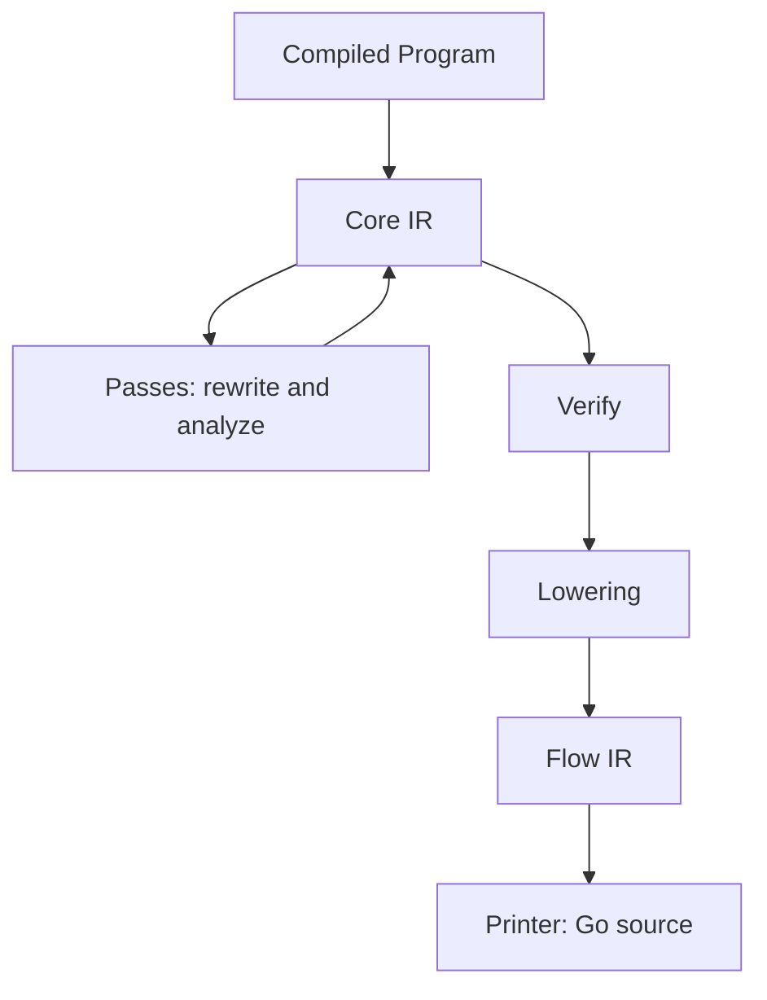

# Core and Flow IR

Core IR and Flow IR are the two internal representations between a checked grammar and the code a backend emits. This
page explains why there are two, what each one is for, and how optimization works on them. It deliberately omits field
tables, node inventories and call sites: those change often and the code, starting with the package comments of
`internal/engine/core` and `internal/engine/flow`, is their source of truth. The reasons behind the design are in
[record 062](records/062-backend-independent-optimization-ir.md); the whole system is in
[Architecture](architecture.md). The exact definitions are in the [Core IR Specification](../../spec/core-ir/README.md), including the [text form](../../spec/core-ir/text-form.md), which prints the module of this page's example in full. Nothing here is a public API.

## Two Levels



| | Core IR | Flow IR |
|:--|:--|:--|
| Question it answers | What does this rule mean? | How does a parser run it? |
| Shape | A tree of grammar-level expressions, each carrying facts | Variables, blocks, loops and primitive operations |
| Optimized by | Rewrites that are valid for any backend | Choices of representation only |
| Knows about | Input consumed, expectations, captures, failure | Parser state, control flow, the runtime's primitives |
| Knows nothing about | Host-language syntax and parser state layout | The grammar's alternatives and repetitions as such |

The split keeps two kinds of reasoning apart. Whether a rewrite preserves what the grammar means is a question about
grammars and is answered once, at the level where it is easy to state. How to turn the result into fast code is a
question about a particular runtime and is answered at a lower level that no longer has to be correct about grammars.
A new target that reuses Core IR inherits the rewrites; a change to how loops are written does not touch them.

## Core IR

Core IR is a module of rules whose bodies are trees of expressions: sequences, choices, repetitions, lookaheads,
literals and classes, calls to other rules, captures, and the actions that build values. It is built from the compiled
program, so it starts from decisions already made, such as which rules are memoized or value-free.

### Effects Are Explicit

Every node carries attributes computed from its subtree: whether it can match empty input, which input can start it,
and which effects it can have. The effects are what a parse can do besides returning a boolean: consume input, fail,
record an expectation, write a capture, cut, recover from an error, call another rule, or raise an error that ends the
parse.

Making effects explicit is what makes optimization safe to state. "This alternative can only start with a comma" is a
checked fact, so a choice may skip alternatives without trying them. "This repetition has no capture and no call"
lets a loop be a tight scan. A rewrite is allowed exactly when it does not change an effect that anything can
observe: the input consumed, the expectations recorded at the farthest failure, the order of captures and errors.

### Kinds of Node

Nodes fall into a few families: matching, combining, structure (calls, captures, scopes), control (cut, recovery, left
recursion, Operators Rules), the terms of actions, and the optimized forms that passes introduce. The exact kinds and
what each one means are defined in the [Core IR Specification](../../spec/core-ir/nodes.md); a new node should fit one of
the families.

### What the Verifier Guarantees

`core.Verify` checks, once after the passes, that the module is well formed and that the facts on it are true. In
principle it guarantees four things.

- **Referential integrity.** Every call, capture and slot reference points at something that exists in the scope it
  names, and the call graph equals the one computed from the bodies.
- **Facts match structure.** Guards, first terminals and similar attributes equal what the structure implies, so a pass
  cannot leave a stale fact behind.
- **Forms stay in their place.** Constructs that the runtime supports only in certain positions (an Operators Rule as a
  whole body, a stream at the top of a start rule) appear only there, and optimized forms contain only what they can
  represent.
- **Types are complete** in a typed module: every term, slot and rule value has a checked type.

The individual invariants are listed in [Invariants](../../spec/core-ir/invariants.md).

## Optimization

An optimization is a pass: a function from a module to a module. There are two kinds.

- **Analyses** compute facts and store them on the module (the call graph; nullability, first terminals and effects of each
  node). They never change meaning.
- **Rewrites** replace an expression with a cheaper one that does the same thing. Each rewrite has a precondition, the
  facts it needs, and an obligation, what it promises to preserve.

A rewrite is safe when its precondition is established and the replacement is indistinguishable from the original on
every input: same input consumed, same value, same error, same expectations at the same positions. Preconditions are
satisfied by running analyses first and are invalidated when a rewrite changes what an analysis computed, so analyses
are run again after rewrites. How each rewrite proves itself is written beside it, as a comment, and tested by
differential runs against the reference backend, which is the oracle.

For example, replacing a choice's blind tries with guarded ones is safe because the guard equals the alternative's first
terminal, the literal or class that `Analyze` proves every match of that alternative starts with: when the guard rejects
the next character, the alternative would have failed there anyway, with the same expectation. Turning a value-free
repetition of a character class into a scan is safe because it consumes the same characters, writes nothing and
records the same expectation when it stops.

The order passes run in, which are enabled for a target, and how they are configured are decisions of the generator;
[record 063](records/063-configurable-optimization-pass-pipeline.md) is the design of the pass pipeline: declared passes,
presets and a flag per optimization.

### A Worked Example

A grammar with a rule that matches optional whitespace and one that reads a name:

```pego
package list

type Item = { Name node[string] }

@start
rule main = items:item+ $$

rule item Item = ws n:name ("," / ";")? => Item{Name: $n}

rule name node[string] = [a-z]+ #atomic

rule ws = [ \t]*
```

The module as built from the compiled grammar, for the rules `item`, `name` and the value-free twin of `ws` (rules 0
and 3 are left out), printed by the engine's printer:

```text
rule 1 item memo transient scope=[n] => Item{Name: $0:n}!
  seq
    call 4:ws
    capture 0 n
      call 2:name
    opt
      choice
        alt
          lit ","
        alt
          lit ";"
rule 2 name want memo transient plain scope-value(k=1,mode=1)
  text
    repeat 1 -1
      class [a-z]
rule 4 ws memo transient plain novalue
  repeat 0 -1
    class [\u0020\u0009]
```

After term rewriting, analysis, guards and scans, the same rules read:

```text
rule 1 item memo transient scope=[n] => Item{Name: $0:n}!
  seq
    call 4:ws
    capture 0 n
      call 2:name
    opt
      choice
        alt guard=','
          lit ","
        alt guard=';'
          lit ";"
rule 2 name want memo transient plain scope-value(k=1,mode=1)
  text
    scan [a-z] 1 -1
rule 4 ws memo transient plain novalue
  scan [\u0020\u0009] 0 -1
```

Analysis also attaches the attributes that the printer shows in brackets. For the choice of `item` they are:

```text
choice [consume,fail,expect]
  alt guard=','
    lit "," [first=',' consume,fail,expect]
  alt guard=';'
    lit ";" [first=';' consume,fail,expect]
```

Each alternative of the choice gained a guard, which is the first terminal that analysis computed for its literal. In
`name`, the value-free repetition `[a-z]+` under `#atomic` became a scan. `item` calls the value-free twin of `ws`, rule
4, because it wants no value there, and the twin's repetition became a scan over the whitespace class; the twin's
value-building sibling, rule 3, is unchanged. Before analysis a node carries only whether its value is wanted and its
shape; nullability, first terminals and effects appear once analysis has run. None of the rewrites changes what any input
consumes or expects.

## Flow IR

Flow IR is the body of one rule variant written as parser-state operations with structured control: variables for
position and results, labeled blocks and loops, and a small set of primitives that map to runtime calls. It contains no
host-language text, so a printer has little to decide.

Two forms exist because rules differ in who owns their captures. A local function keeps captures as variables of the
function. A framed function is for bodies whose captures the runtime keeps in frames, such as left-recursion leaders,
rules with recovery and each line of an Operators Rule; the runtime owns the frame and the value. Lowering fails
loudly on a Core construct it does not support rather than guess, and a verifier checks the shape of the result in
tests.

Optimization at this level only chooses representation: what state to save and restore, which variables to use and where
the work charges go. It never changes meaning. Decisions about meaning are made on Core IR, and Flow IR optimizations may
use the effects that Core IR computed to know what must be kept.

## How Targets Use the Result

A target takes Core IR, Flow IR or neither. Generated Go for typed parsers and for the value-free rules of the Node parser and its
recognizer is printed from Flow IR; other generated Go, the closure backend, the bytecode compiler and generated TypeScript read the grammar
or the compiled rules directly. Actions and predicates are printed from the grammar terms that Core nodes record,
because their text belongs to the target language. Which target uses which representation is expected to change as
more of them move onto Core IR; the generator code and record 062 are the current statement.

## Related Topics

- [Architecture](architecture.md): the stages around these representations.
- [Record 062](records/062-backend-independent-optimization-ir.md): why the representations exist and the rewrites with their obligations.
- [Record 063](records/063-configurable-optimization-pass-pipeline.md): the pass pipeline, its presets and per-optimization flags.
- [Optimization catalog](../optimizations/README.md): measured mechanisms.
