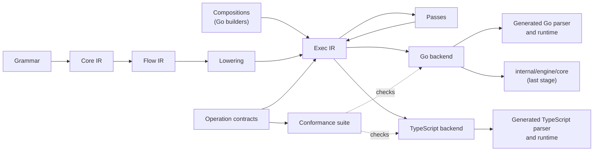

# 065. Exec IR: One Parser VM Specified for Every Target

- **Status**: Proposed
- **Author**: @ornew
- **Date**: 2026-10-31

## Summary

The algorithmic core of a ZeroParse parse — memoization, left-recursion growth, expected-set merging, recovery bookkeeping,
the variable environment, budget charges, stream commitment, Document reuse and the Operators Rule loop — is written
once per runtime: in the engine (`internal/engine/core`, shared by the closure backend and both bytecode VMs), twice in
the generated Go runtime (the node `Parser` in `runtime/runtime.go` and the typed `TParser` in `runtime/typed.go`), and
in the TypeScript runtime (`internal/gen/tsgen/tsrt/runtime.ts`). A fix to one of these mechanisms is a fix to up to four
copies, and the copies already differ in algorithm where they should only differ in host.

This design specifies the **parser VM** once. **Exec IR** (`internal/ir/exec`) is that specification: it declares the
operations a parser VM provides — memo lookup and store, seeding a left-recursion growth, entering and leaving a
lookahead, merging expected sets, recovery bookkeeping, binding variables, charging the budget, committing a stream,
validating a reused Document result — each with a behavior contract over an abstract parser state, and it composes
them into the parse: the call protocol, the growth loop, the Operators Rule loop, and the grammar code lowered from
Flow IR ([record 062](062-backend-independent-optimization-ir.md)). An operation states what happens, not how; each
target backend implements every operation in its own language and optimizes it freely for that language, and a
conformance suite per operation, which every implementation must pass, is what makes that freedom safe.

Shared across targets: the contract of each operation, the composition of operations, the passes on Exec IR, and the
conformance suite. Chosen per target: the representation of the parser state, the implementation of each operation,
and how the composition is printed.

Flow IR is lowered into Exec IR from the start, so each language has one backend that prints grammar code and the
runtime alike. Compositions are written with Go builder functions. Migration starts with a pilot of memoization and
left-recursion growth on generated Go (node and typed) and TypeScript, and every stage, the pilot included, applies
the same performance gates to grammar code as to the runtime.

## Motivation

The evidence below was measured at commit `f52b6bd9`. The repository history starts on 2026-10-07, so the window
covers 2026-10-07 to 2026-10-30: 1,263 commits.

### Four Copies of One Core

The engine's closure backend and both VMs already share one core: they drive `CallBegin`, `CallEnd`, `GrowBegin`,
`GrowStep` and `GrowEnd` in `internal/engine/core/runtime.go`. The generated runtimes do not use it. The generated Go
runtime has one copy for node results and one for typed results, and the TypeScript runtime a fourth.
[Appendix A](#appendix-a-inventory) lists every mechanism with its files, functions and sizes. In approximate lines:

| Mechanism | Engine | Go node | Go typed | TypeScript |
|:--|--:|--:|--:|--:|
| Memoization, deferred memoization and the call protocol | 520 | 580 | 300 | 330 |
| Left-recursion growth | 80 | 30 | 25 | 30 |
| Expected-set merging | 85 | 215 | 30 | 155 |
| Operators Rule loop | 340 | 260 | 255 | 310 |
| Variable environment | 90 | 145 | 40 | 85 |
| Budget charges | 1,800 | 1,410 (shared) | — | 500 |
| Stream commitment | 350 | 180 | — | none |
| Document reuse | 540 | 200 | 250 | none |

On top of the copies per runtime, each runtime keeps hand-written variants per mode: the generated Go runtime has 72
functions suffixed `Ordinary`, `Controlled`, `Spend` or `Budget`, and the TypeScript runtime 28 `…Spend` functions,
that repeat a body with or without budget charges.

### Changes Paid Several Times

Of the 1,263 commits, 79 touched the non-test sources of two or more of the four copies (the engine runtime files
under their former and current paths, `runtime/` or its former `internal/engine/genrt/`, and the TypeScript runtime
under its former and current paths; the copy in `gen/_runtime` is mechanical and not counted). Classified by hand:

| Kind | Commits | Examples |
|:--|--:|:--|
| Core mechanism semantics or cost | 22 | the left-recursion guard keyed by rule and position; reuse of results with recovered errors only in the same context; adaptive memo counter overflow; sparse seen pages; one work budget; memo growth charged by demand; Pratt nesting and committed prefixes; bounded binding histories |
| Term evaluation and the value model | 35 | named node types, tuple literals, variable binding checks, `concat` fusion |
| Host-specific (input, output, API) | 9 | case-insensitive literals, JSON ranges, start rule selection |
| Renames, moves and cleanup | 12 | moving the generated runtime into a package; budget naming |
| Initial import | 1 | |

Of the 22 core commits, 8 touched all four copies, 7 touched three, and 7 touched two. The core commits by mechanism
(a commit may count under two): budget 8, memoization 7, Operators Rule 3, expected sets 2, environment 2, left
recursion 1, recovery 1, stream 1, rule completion 1, depth 1. 47 of the 79 commits edited both the node and the
typed Go copy.

The copies also drift where no test observes it. In a Document parse the engine records how many reads of a growing
seed a result made (`MemoSeedUses`, `ActiveSeed`) and discharges a leader's own reads when it stops growing, while the
generated Go runtime marks every leader result and every result that read a growing entry provisional
(`docProvisional`). The generated rule is the more conservative of the two, so the two can reuse different results
after the same edit.

### The Mechanisms Are Host-Neutral

Most of the core is integer and pointer work over the parser's own structures: position-indexed slot arrays, chained
memo entries, bit pages, counters, persistent environment lists and a stack of expectation identifiers. It touches
the host only to read input, to compare and build values, to report events and to check cancellation. That boundary
already exists in each copy; it is not written down.

## Goals

- Each core mechanism has one specification and one composition, shared by every runtime that needs it: generated Go
  (node and typed), generated TypeScript and, in the last stage, the engine.
- Each target implements the operations in the form that is fastest for its language, and a change of
  representation in one target needs no change in any other.
- Every operation implementation passes the same conformance suite, so that a target cannot drift from the contract
  without a failing test.
- Every parse returns byte-identical results to today on every target: values, JSON output, errors, expected sets,
  recovered errors, positions in both units, budget counts (`budget.golden`), and trace and profile event streams.
  Document statistics change only where a stage unifies an algorithm and states the change.
- No stage changes parse time, allocations, generated size or generation time beyond measurement noise, for grammar
  code and runtime alike, measured per target as in [Performance Acceptance](#performance-acceptance).
- Printed code is readable, formatted, commented, deterministic and checked in, so that it can be debugged, profiled
  and reviewed as hand-written code is.
- A new target language needs one backend — its operation library, its printer and its host code — not a new core.

## Non-Goals

- Changing Core IR, Flow IR or their passes. Flow IR gains a lowering into Exec IR; its passes still run before it.
- Changing the grammar language, the public API, the bytecode instruction set or the specification of any mechanism.
- Adding Document or stream parsing to TypeScript. A shared composition makes it cheaper; whether to add it is a
  separate product decision.
- A textual Exec IR syntax, an editor ecosystem or a serialized or public Exec IR. Builders come first; a text form is
  an extension that this design leaves room for.
- A second bytecode VM in another language ([The Engine and a Second VM](#the-engine-and-a-second-vm)).

## Design

### Three Levels

| | Core IR | Flow IR | Exec IR |
|:--|:--|:--|:--|
| Question it answers | What does this rule mean? | How does a parser run this rule? | Which operations of the parser VM run, in what order, and what does each do? |
| Written by | The Core IR builder, from the grammar | Lowering, from Core IR | Lowering, from Flow IR; compositions written with Go builders |
| Content | Parsing expressions with effects | Registers, slots, blocks, parse primitives | Operations with contracts over an abstract parser state, and their composition |
| Optimized by | Grammar rewrites | Save/restore elision, slot allocation, charge placement | Feature specialization, operation elimination, charge coalescing, inlining |
| Turned into code by | — | — | One backend per target language |

The names say what each level holds. Core IR is the core language of a grammar: what remains of its meaning once the
surface syntax is gone. Flow IR is the control flow of a parse. Exec IR is the executable form: the operations of a
parser VM and the program that drives them. Its package is `internal/ir/exec`, beside `internal/ir/core` and
`internal/ir/flow`.

[Record 062](062-backend-independent-optimization-ir.md) keeps runtime algorithms out of Core IR and Flow IR: Flow IR
calls them as runtime services (`CallRule`, `Isolate`, `MergeExpected`, `StreamStart`) and rejected a third level
without passes of its own. Exec IR keeps that boundary for Flow IR and gives those services a home with passes of
their own: a Flow IR primitive lowers into a call of an Exec IR composition or operation, and the composition is
where the service's algorithm is written once.

### The Parser VM

A **parser VM** is the abstract machine that runs a parse. It is not the bytecode VM: the bytecode VMs, the closure
backend and every generated parser are hosts of the same parser VM. Exec IR specifies it in three parts.

- **Abstract state.** Registers — the position, the examined bounds, the silent depth, the cut flag, the nesting
  depth, the counters of provisional reads — and state components: the memo table, the seen set of deferred
  memoization, the expectation record, the recovered-error list, the variable environment, the capture frames, the
  budget, the statistics, the stream window and the Document generation. The state is abstract: a contract talks
  about it, a target chooses how to represent it.
- **Operations.** Each operation is a transition of the abstract state with a declared signature, a behavior
  contract, a precondition (`Requires`) that its callers guarantee, the state components it reads and writes, its
  cost contract, the features it belongs to and the laws that passes may use. Behavior outside the precondition is
  unspecified, and conformance never exercises it: two implementations may differ on states that no composition
  reaches. Handles that operations return (a memo entry, an expectation mark, a recovery mark, a frame)
  are opaque; a memo entry exposes its specified attributes (outcome, end, examined bounds, silent, recovered errors,
  growing, provisional) through accessor operations.
- **Composition.** Exec IR functions that sequence operations under structured control: blocks, `if`, `loop` with
  labeled `break` and `continue`, `return`, labeled block exits, calls to functions, operations, rule bodies and host
  primitives. There is no `goto` and no exception; a fatal condition is an operation that does not return. Locals are
  scalars (`bool`, `int`, sized `i32`, `u32`, `u64` with defined wraparound) and handles. Compositions have no
  records, arrays or maps of their own: data structures live inside operations, where targets choose them.

The host is what touches a value, an input encoding, the user or the platform: input decoding, value and node
construction, value equality, error text, readers, edits and snapshots, cancellation, tracing sinks and the public
API. Host primitives are declared in Exec IR with typed signatures and implemented once per target; values and nodes
are opaque to the parser VM.

### The Operation Boundary

The boundary decides whether the design pays off. With operations too coarse, an operation hides a policy — whether
a memo result may be reused, when growth stops — and every target re-implements that policy: four copies again,
behind a shared name. With operations too fine, an operation is a step of a data structure — set bit `k` of page
`p` — and Exec IR becomes Go-like code that fixes one representation and leaves nothing for a target to optimize.

An operation is placed by four rules.

1. **No parse decision inside.** An operation never chooses between outcomes of the parse: reusing or recomputing,
   growing or stopping, which error or expectation survives. Those choices read operation results and entry
   attributes in a composition, which is written once.
2. **Complete contract.** Everything an operation does that can be observed — its results, the abstract state
   afterwards, the statistics it counts, and its cost — follows from its contract, so that a test can check it
   without knowing the implementation.
3. **Representation stops the split.** An operation is not divided further once the parts would only make sense for
   one data structure. Its implementation is where a target picks slot arrays or hash maps, slabs or the garbage
   collector, the word size of a bit page, a membership filter.
4. **No re-entry.** An operation does not run grammar code. Where a mechanism must run a rule body in the middle — a
   memoized call, a growth step — it is a composition, or a begin and an end operation around the body.

The measured history supports these rules. Each of the 22 core commits of [Changes Paid Several
Times](#changes-paid-several-times) is placed below by the part of this design it would change (classified by hand
from the commits' subjects and the mechanisms they touched; the placement is approximate):

| Change lands in | Commits | Examples | Cost under this design |
|:--|--:|:--|:--|
| A composition | 11 | the left-recursion guard keyed by rule and position; reuse of results with recovered errors only in the same context; Pratt nesting, committed prefixes and empty applications; default budgets and the input limit at parse entry; splicing hidden rules into their caller; the iterative VM's plain call path | One edit, printed for every target |
| A pass | 1 | splitting the budget-controlled bodies off the helpers | Done by feature specialization; no hand edit |
| An operation contract | 6 | one work budget; memo growth charged by demand; bounded binding histories; adaptive memo counter overflow; charges of a CodePoints preparation | One contract and conformance edit, and one implementation edit per target, each checked by the suite |
| One target's representation | 3 | sparse seen pages; a membership filter before exact expectation scans; a shared memo key where no variable is defined | Optional per target; no shared change |
| Several parts | 1 | cancellable parsing and work limits | Contract, composition and implementations |

Under this boundary 12 of the 22 changes become a single edit or none, and 3 need no cross-target work at all. The 6 contract
changes still touch every target, but each is a small, specified change guarded by the conformance suite instead of
a re-derivation of an algorithm.

### Operations

The operations, grouped by the state they own. Each entry gives the contract, what is shared, what a target chooses
and how conformance is tested. Costs follow [Cost Contracts](#cost-contracts).

**Input** (`peek`, `matchLiteral`, `matchClass`, `matchAny`, `advance`, `text`). Reads at the position in the
parse's position unit, advance by characters, and, in a Document, extend the examined bound to every element read.
*Shared*: the meaning of positions in both units and of the examined bound. *Target*: decoding, buffers, fast paths
for ASCII or decoded code points, literal matching by machine word. *Conformance*: inputs at UTF-8 and UTF-16
boundaries, invalid sequences, both units, the examined bound after each read, and the input charge.

**Memo table** (`memo.lookup`, `memo.lookupGrowing`, `memo.store`, `memo.seed`, `memo.reseed`, `memo.finishSeed`,
`memo.prune`). `lookup` returns the most recent entry stored for a key (rule, position, binding level, variable
values, missing-token mode), or none; `lookupGrowing` returns the growing entry of a rule at a position whatever the
variable values; `store` adds an entry that later lookups of its key return; the seed operations install, replace and
finish the growing entry of a left-recursion leader; `prune` drops entries below a position. The precondition of
`lookup` is that a rule with a growing entry at a position and level is looked up there only with the key it was
seeded with; compositions call `lookupGrowing` first for a leader. The generated Go memo table, whose lookup also
matches a growing entry under other key values, and the engine's, whose lookup is exact, then agree. *Shared*: keys, the
specified entry attributes, which entry a lookup returns, the storage charge. *Target*: slot arrays or maps, chaining,
slab allocation and free lists, entry layout and packing. *Conformance*: random sequences of stores, seeds, lookups and
prunes compared with a reference model; storage charges that do not depend on storage left by an earlier parse, as
[Cancellation and Budget Limits](../../../spec/runtime/parsing.md#cancellation-and-budget-limits) requires.

**Deferred memoization** (`seen.first`). Records a call of a memoized rule at a position and reports whether it is
the first, under the adaptive policy: per-rule counters and the switch to eager memoization. The policy is part of the
contract, because it decides how many bodies run, which `Evaluated` reports. *Shared*: the policy and its thresholds.
*Target*: dense or sparse pages, word size, counter width. *Conformance*: call sequences over many rules and positions,
counter saturation, pages created on demand.

**Expectations** (`expect`, `exp.isolate`, `exp.unisolate`, `exp.keep`, `exp.merge`, `exp.rename`, `silent.enter`,
`silent.exit`). The expectation record is an insertion-ordered set of expectation identifiers at the farthest
position; `expect` at a position beyond it starts a new set, below it does nothing, and inside a silent scope does
nothing. `isolate` starts a separate record and `unisolate` ends it, returning its farthest position and set; `keep`
makes a set that outlives the record; `merge` adds a set at a position. *Shared*: the set algebra and its order, which
error messages expose. *Target*: membership filters, stack layout, sharing of kept sets. *Conformance*: random
sequences against the reference model, compared by farthest position and exact order.

**Recovery** (`rec.mark`, `rec.rollback`, `rec.since`, `rec.append`, `rec.push`; with `#missing` in the engine,
`missing.mark`, `missing.reset`, `missing.replay`). An ordered list of recovered errors with marks; `rollback` removes
everything after a mark, `since` returns it for a memo entry. *Shared*: order and rollback. *Target*: list growth and
sharing. *Conformance*: interleaved pushes, marks and rollbacks.

**Variable environment** (`env.bind`, `env.lookup`, `env.save`, `env.restore`, `env.key`). A persistent scope:
bindings made after a `save` are gone after `restore`; histories are bounded as specified; `env.key` returns the
values of a rule's variables for its memo key, and two keys are equal when the host's value equality says so.
*Shared*: scoping, bounds, key equality. *Target*: list or array, shared keys for the initial environment, history
compaction. *Conformance*: nested scopes, shadowing, long histories, keys of equal and unequal values.

**Capture frames** (`frame.open`, `frame.set`, `frame.mark`, `frame.reset`, `frame.close`). Slots of a rule body and
a trail of writes that a backtracking point resets. *Shared*: what a reset restores. *Target*: pooling and scratch
reuse. *Conformance*: nested frames, resets across repetitions.

**Budget** (`charge`). Adds units to the one work budget, checks the limit and, at intervals the target chooses,
cancellation through a host primitive; it does not return when the parse is interrupted. Charges are never rolled
back. *Shared*: when a charge interrupts. *Target*: counter representation and the cancellation interval.
*Conformance*: interruption exactly at the limit, with and without a cancellation signal.

**Nesting, statistics and observation** (`depth.enter`, `depth.exit`, `stats.count`, `trace.event`). The nesting
limit is fatal when exceeded; statistics are counters; trace events go to a host sink. *Shared*: when each counts or
reports. *Target*: the sink. *Conformance*: the limit at its boundary; event sequences of small compositions.

**Stream window** (`stream.commit`, `stream.discard`, `stream.demand`). `commit` makes everything before a position
final: its input, memo entries and scratch are released, and later reads before it are fatal; `demand` reports the
position the parse needs, which the default budget of a stream follows ([Streaming](../../../spec/runtime/streaming.md)).
*Shared*: what a commit releases and finalizes. *Target*: buffers and pruning strategy. *Conformance*: lookups and
reads below the committed position, scratch after a commit.

**Document reuse** (`doc.validate`, `doc.move`, `doc.resume`, `doc.splice`). `validate` advances a memo entry over
the edits since its generation and reports whether it is still valid: no edit touched its examined range; `move`
shifts a reused result to its new position through a host primitive on nodes; `resume` reuses a prefix of a repetition;
`splice` shifts the memo table at an edit. Whether a valid entry is reused, and whether a result is provisional,
stays in the composition. *Shared*: validity and the positions after a move. *Target*: side tables, lazy shifting.
*Conformance*: edit sequences before, inside and after examined ranges, compared with a parse from scratch.

The Operators Rule loop has no operation of its own beyond a longest-operator match on input
(`operators.longest`): the loop, binding powers, prefix commitment and the application order are composition, which
is where all three of its core changes landed. Term evaluation and the value model join in a second wave as host
primitives ([Decisions](#decisions)).

### Compositions

The compositions written once in Exec IR are the algorithms that the copies re-implemented:

- the call protocol: deferred memoization, memo lookup and the reuse conditions (silent results, recovered errors,
  growing entries, the missing-token mode), store, restore on failure, nesting and statistics;
- left-recursion growth: seed, the growth loop, its stop condition and the guard keyed by rule and position;
- rule completion: the rule's value, captures and hidden rules spliced into their caller;
- Document calls: validation, reuse and provisional tracking of results that read a growing seed;
- the Operators Rule loop;
- stream delivery and commitment points;
- parse entry: start rule, default budgets and the input limit.

Grammar code is composition too: a rule body lowered from Flow IR calls the same operations. A composition that must
suspend while a rule body runs, as the iterative VM needs, is also available as a begin, step and end split over a
small state record; a backend that recurses fuses them back into one function.

### Cost Contracts

A charge sits either in a composition or inside an operation. A charge in a composition — one per call, per growth
step, per loop iteration, per Operators Rule application — is shared and exact on every target. A charge inside an
operation pays for work whose size depends on the operation's data: scanning an expectation record, growing the memo,
inspecting input. The specification already lets budget counts depend on the backend and the generated artifact as
long as they are deterministic ([Cancellation and Budget
Limits](../../../spec/runtime/parsing.md#cancellation-and-budget-limits)), and the targets already differ here:
generated Go charges an expectation scan only after its membership filter matches, TypeScript charges every element
it scans. An operation's cost contract is therefore a deterministic count per target within a declared bound
([Decisions](#decisions)).

A bound is a constant plus a sum of terms, each a positive coefficient times an abstract quantity: a measure of the
state before the call that the reference model of the component defines and computes, such as the key values of the
entries at the call's position, or the positions a position-indexed memo copies when it doubles. A bound is the worst
case over the representations a target may choose: deferred memoization is bounded both by the regions a sparse
record allocates and by the size of a dense record of calls in position order.

Charges inside an operation spend the same budget that `budget.charge` and `budget.used` see. The conformance suite
measures what an implementation charges in each call, checks it against the bound and adds it to the model's budget;
an implementation may end the parse with a limit interruption inside an operation only when charges within the
bound could exceed the limit.

### Authoring

Compositions, operation declarations and conformance cases are written with Go builder functions in
`internal/ir/exec`. A builder returns Exec IR that the verifier checks: types, definite assignment, that every exit
names an enclosing block, that operations are called with their signatures and features, that each state component is
written only by the operations that declare it, and that a specialization leaves no reference to a folded feature.
The IR has a text dump for tests, golden files and error messages, and an interpreter that runs a function against a
machine of operations, which is how Go runs conformance cases until a backend prints them. A textual syntax, parsed
by a ZeroParse grammar, can be added later without changing the IR.

### Passes

Exec IR passes know operations by their declarations, not by name:

- **Feature specialization.** Features (`budget`, `document`, `observe`, `missing`, `stream`, `typed`) are constants;
  a function specialized for a set of them folds the constants and removes dead code. The hand-written `…Ordinary`,
  `…Controlled` and `…Spend` variants and the node and typed copies become specializations of one composition.
- **Operation elimination.** An operation whose effect is unobserved is removed, using the declared reads and writes
  and the declared laws: a save and restore of a component that nothing between them writes; an `isolate` and
  `unisolate` pair around code that records no expectation; examined-bound recording outside a Document; trace
  events outside an observable build.
- **Charge coalescing.** Charges in straight-line code merge, under the invariants of record 062: each loop iteration
  charges, input is charged before it is inspected, and no charge moves across a commit. Budget counts stay as
  `budget.golden` pins them unless a stage states otherwise.
- **Inlining** of compositions into callers, within a budget that the backend sets per target.
- **Cold-path marking** of error paths, growth and Document bookkeeping, which a backend may outline.
- **Protocol fusion**: begin, body and end fused where the target recurses.

Flow IR keeps its own passes; they run before lowering.

### Target Backends

A backend turns Exec IR into code for one language. It has three parts:

- an **operation library**: the implementation of every operation and of the parser state, written in the target
  language and tuned for it;
- a **printer** for compositions and grammar code, which decides per call whether an operation is expanded inline
  or called;
- a **conformance runner** that executes the conformance suite against the library.

The Go backend serves the generated runtime and, in the last stage, the engine; its operation library has one
source, printed with the value type of each. The tuning that the hand-written runtimes encode today becomes the
backends' choice.

**Go.**

- State prints as structs with fields in the order the library declares, so that hot fields share a cache line and
  packed `i32` fields stay adjacent, as in `memoEntry`; pooled entries print as a slab arena with a free list.
- Hot functions stay within the inlining budget (cost 80) by outlining cold paths; a test reads the inlining cost of
  each printed hot function from `go build -gcflags=-m=2`, so that a change that pushes one over the budget fails a
  check instead of a benchmark.
- Split protocol state stays on the caller's stack, passed by pointer only to non-escaping parameters.
- The node and typed specializations print as two monomorphic copies, not one generic function: a type parameter
  instantiated with `*Node` and `any` would share one GC shape and pay dictionary calls.

**TypeScript and JavaScript.**

- State prints as classes whose constructors initialize every field, in declared order, with a value of its type
  (`null` for references, `0` for numbers), so that every instance has one hidden class and access stays monomorphic;
  references use `null`, never `undefined`.
- `i32` and `u32` stay small integers; `u64` bit pages print as pairs of 32-bit words; integer arrays print as typed
  arrays and reference arrays are allocated at their final length, so that they never become holey.
- Loops print as `for (;;)` with labeled `break`; no iterator protocol or closure appears in a hot path.

Printed code is checked in: the Go runtime in `runtime/` (and its copy in `gen/_runtime`), the TypeScript runtime in
`internal/gen/tsgen/tsrt/`, and the engine's in `internal/engine/core`. A test regenerates them and fails on any
difference, as the runtime copy test does today. Names come from the compositions and operations, with a suffix only
for a specialization; each printed function starts with a comment naming its source and specialization, so that a
stack trace or a profile leads back to it; comments carry through; output is formatted by `go/format` and by the
TypeScript printer's formatter.

### Testing

- **Conformance suite.** Every operation has conformance cases: small Exec IR functions, written with builders, that
  call operations and state the expected results, abstract state, statistics and charges. Each backend prints them
  into a test program in its language and runs it, so that a case runs the same way on every target; until a
  backend exists, the interpreter runs them in Go. A case runs in lock-step on the reference model and on the
  implementation, and fails at the first call where they differ in results, in which handle a result is, in whether
  the parse ends, or in charges beyond the bound. Randomized sequences draw arguments from small domains, so that keys
  collide, and keep to every precondition by consulting the model while they are drawn. A conformance case is added
  with every contract change and every bug found in an implementation.
- **Bindings of existing runtimes.** Before a backend prints an operation library, an existing runtime is checked
  through a test binding that calls its functions. Where an operation is inline code of a composition, the binding
  does what that code does: in the generated Go runtime, `memo.seed` and `memo.reseed` allocate an entry and store it
  with `memoPut` as `grow` does, and `memo.finishSeed` clears the entry's growing flag.
- **Mutation controls.** Each operation library has deliberately broken variants — an off-by-one prune, a lookup that
  ignores the binding level, a counter that wraps — that the suite must reject.
- **Differential tests.** Within a stage the old and new paths run side by side behind a private switch, as record 062
  does for its stages. The existing differential tests between the engine, generated Go (node and typed), Documents,
  streams and TypeScript run with the switch on and off, on the corpora of record 062: repository grammars with
  golden files, specification test data, grammar fixture suites, `sample/` inputs and mutated inputs. Results must be
  byte-identical as listed in [Goals](#goals). The switch is removed when the default flips.
- **Negative controls for compositions.** Each migrated composition has broken variants that the differential tests
  must detect, for example: reusing a silent result outside a lookahead; looking up a growing entry by variable values
  instead of by rule and position; storing a result that read a growing seed as complete in a Document; omitting the
  expectations of a reused entry.
- **The engine as oracle.** Until the engine adopts the shared core it is an independent implementation, so a bug in
  a composition shows as a difference between the engine and generated parsers. After it adopts the core, golden files
  and fixture expectations, which no backend derives, are the independent checks.
- **Budget determinism.** `budget.golden`, the budget determinism tests and the ordinary-versus-controlled parity tests
  of each target pass unchanged unless a stage states why a count changes.
- **Printer tests.** For each Exec IR construct, small functions printed for each target and executed: integer
  wraparound, labeled exits, specialization, protocol fusion.

### Performance Acceptance

The baseline of each stage is the commit before it, on the same machine. The gates apply to grammar code and to the
runtime alike, because every stage prints grammar code through the Exec IR backend.

- **Go.** `bench` `BenchmarkParse`, `BenchmarkRecognize`, `BenchmarkIncremental`, `BenchmarkIncrementalLong` and
  `BenchmarkStream`, for node and typed parsers, in both position units, with and without budget controls; at least
  ten samples, base and head interleaved, compared with `benchstat`.
- **TypeScript.** The Node benchmarks (`bench/ts-parse.mjs`, `bench/ts-typed.mjs`), ten interleaved samples.
- **Engine** (final stage). The full-suite benchmarks of the closure backend and both VMs, in both families of
  record 062, and `Compile` time.
- **Size and build.** Generated source bytes per repository parser, Go runtime source bytes and the binary size of each
  generated parser package; TypeScript runtime bytes and gzipped bytes; generation time of `zp gen` for each
  repository parser.

A stage is accepted when no benchmark shows a statistically significant slowdown in `sec/op` (benchstat, p < 0.05),
`allocs/op` are equal, `B/op` and sizes are within noise, and budget counts are unchanged or explained. With hundreds
of benchmark rows some cross p < 0.05 by chance, so a flagged row is accepted as a regression only when a second
interleaved run reproduces it. A trade-off that is faster on one workload and slower on another is not accepted by
default; it can become an option of its own.

### The Engine and a Second VM

The closure backend and both VMs already share `internal/engine/core`, so the engine is one copy, not three. It
adopts the shared core last: the Go backend prints the compositions into `internal/engine/core` with the `missing`
feature and the split protocols that the iterative VM needs, over the Go operation library with the engine's value
type. Until then it is the independent oracle of the differential tests.

The bytecode instruction set is specified independently of Go ([Bytecode](../../../spec/bytecode/README.md)). A VM in
another language needs a dispatch loop, load-time validation and the parser VM; with this design the parser VM comes
from that language's backend. Whether a second bytecode VM is worth having is measured against the generated parser
of the same language first, and is not part of this design.

### Migration Order

Each stage is accepted by the gates of [Testing](#testing) and [Performance Acceptance](#performance-acceptance)
before the next begins, and a release can be cut after any completed stage. Mechanisms not yet migrated are reached
through **transitional operations**: an existing hand-written runtime function declared as an operation with its
current behavior and no conformance cases, removed by the stage that migrates its mechanism. They let grammar code
move to Exec IR at once while mechanisms move one at a time.

1. **Foundation.** Exec IR, builders, the verifier, the listing and the interpreter; the declarations of the pilot's
   operations, the reference models of their components and the conformance harness, with the generated Go runtime
   as the first implementation checked through a test binding. No output change.
2. **Pilot** ([Pilot](#pilot)): the passes, the Go and TypeScript backends with their printer tests, and the
   transitional operations that the pilot's compositions call; grammar code in the ordinary mode lowered from Flow
   IR into Exec IR, and memoization, deferred memoization, the call protocol and left-recursion growth as specified
   operations and compositions. Passes, printers and transitional operations serve printed compositions: before
   compositions exist, passes have nothing to transform, a printer test has no backend to run, and no composition
   calls a mechanism that has not migrated.
3. **Every mode of grammar code.** Budget controls, observable builds, Document and stream variants print through the
   Exec IR backend over transitional operations; the default flips and the Flow IR printers are removed.
4. **Expected sets, recovery bookkeeping and the variable environment.**
5. **Budget charges and mode specialization.** The remaining `…Ordinary`, `…Controlled` and `…Spend` variants become
   specializations, and the cost contracts are written down.
6. **Capture frames and the Operators Rule loop.**
7. **Stream commitment** (generated Go).
8. **Document reuse** (generated Go). Provisional tracking becomes the engine's algorithm ([Decisions](#decisions)).
9. **Engine adoption.** The compositions and the Go operation library replace the hand-written mechanisms of
   `internal/engine/core`; the closure backend and both VMs run on them.
10. **Term evaluation and the value model**, with value operations as host primitives.

### Pilot

**Scope.** Generated Go (node `Parser` and typed `TParser`) and generated TypeScript, in the ordinary mode without
budget controls, Documents, streams or observation:

- grammar code lowered from Flow IR into Exec IR and printed by the Go and TypeScript backends;
- the memo table, deferred memoization and their operations, with conformance suites and reference models;
- the call protocol of a memoized rule outside Documents and left-recursion growth as compositions.

Expected sets, recovery lists, environments and frames are transitional operations.

**Work.**

1. Write the passes, the backends and their printer tests, and the transitional operations the compositions call.
2. Build the Go and TypeScript operation libraries for them from the current hand-written code, which passes the
   suite before anything else changes.
3. Write the compositions with builders, lower Flow IR into Exec IR, and print both with the switch selecting the new
   or old path.
4. Run the differential tests and benchmarks with the switch on and off.
5. Re-apply one recorded composition change, the left-recursion guard keyed by rule and position, as a single edit,
   and show that it reaches all three targets and that a negative control without it fails on each.
6. Change one target's representation alone — the seen pages of the TypeScript library — and show that the suite
   and the differential tests pass with no change elsewhere.

**Acceptance criteria.**

| Criterion | Measure | Bar |
|:--|:--|:--|
| Identical results | Differential tests, `parsers/test.sh`, fixture suites, switch on vs off | Byte-identical on every corpus and target |
| Identical costs | `budget.golden` and the budget determinism tests | Unchanged |
| Conformance | The pilot operations' suites on Go node, Go typed and TypeScript | All pass; every mutation control fails |
| Detection | Four composition negative controls | Each fails at least one differential test on every target |
| Go speed | `BenchmarkParse`, `BenchmarkRecognize`, `BenchmarkStream` on every bench grammar including `calclr` (left recursion), node and typed, both units; n ≥ 10 interleaved | No reproduced `sec/op` slowdown (p < 0.05); `allocs/op` equal |
| TypeScript speed | `ts-parse` and `ts-typed` on every bench grammar, n ≥ 10 interleaved | No reproduced slowdown |
| Size | Generated source and binary size, Go runtime source, TypeScript runtime bytes and gzip, generation time | Within noise; any growth is reported |
| Inlining | Inlining cost of each printed hot function, grammar code included | Every function inlined today is still inlined |
| Readability | Printed functions next to the hand-written ones | Same structure and names; differences limited to specialization suffixes and comments |
| Single source | Hand-written call protocol and growth code removed from the three copies | Reported |
| Independent optimization | Work step 6 | No change outside the TypeScript library |

If a criterion fails and cannot be met by backend tuning, the pilot stops and its findings decide between this design
and the alternatives.

## Decisions

These are settled.

1. **Three levels**: Core IR, the core language of a grammar; Flow IR, the control flow of a parse; Exec IR, the
   parser VM, in `internal/ir/exec`.
2. **Exec IR specifies operations, not code.** Each operation has a behavior contract; each target implements and
   optimizes it for its language. Shared: the contracts, the compositions, the passes on Exec IR and the conformance
   suite, which every implementation must pass.
3. **Go builders first.** Compositions, operations and conformance cases are built with Go builder functions; a
   textual syntax and its tooling are a later extension.
4. **Flow IR is lowered into Exec IR from the start**, so each language has one backend for grammar code and runtime.
   Because that puts grammar code at risk in every stage, every stage applies the same performance gates to grammar
   code.
5. **The engine adopts the shared core in the last stage**; golden files and fixtures carry the independent checks
   after that.
6. **Where copies differ in algorithm, the engine's algorithm wins**, after measuring the incremental benchmarks on
   both, with the change of `Stats` stated in the stage's record. For provisional seed tracking in Documents, the
   engine reuses more results than the generated runtime; the specification makes reuse visible only through the
   statistics ([Reuse](../../../spec/runtime/documents.md#reuse)), so results do not change.
7. **Printed code is checked in**, with a drift test, as `gen/_runtime` is today.
8. **Term evaluation and the value model are a second wave**, with value operations as host primitives. They account
   for 35 of the 79 multi-copy commits.

9. **Cost contracts are deterministic per target, within a declared bound.** Each operation's contract states an
   upper bound on its charges in abstract terms (for `expect`, at most one unit per element of the current record)
   and requires determinism; the exact count belongs to the target and is pinned by that target's golden counts.
   The budget bounds work, and a bound is what a user relies on; an exact cross-language count would forbid the
   representation choices this design exists to allow, and the specification already lets counts depend on the
   backend. Charges in compositions stay exact and shared.
10. **Each state component has a reference model**: a small, deliberately naive Go implementation of its contract,
    against which randomized operation sequences are compared on every target. It finds what handwritten cases miss
    (counter overflow, page boundaries) and is never printed or optimized, so it does not become another copy to tune.
11. **The Flow IR printers are removed after stage 3**, once every mode of grammar code prints through Exec IR. Each
    language has one backend early; transitional operations live until their mechanism migrates.
12. **A slowdown counts only when a second interleaved run reproduces it.** With hundreds of benchmark rows some cross
    p < 0.05 by chance; a reproduced slowdown fails the stage.

## Alternatives Considered

**A restricted subset of Go as the source of the core.** Write the core in Go, type-check it with `go/types`, reject
what is outside a subset, and translate the rest to every target. The source would run as Go for its own tests and
work with existing tools. It is rejected. Go fixes the procedure — the data structures, their layout, the order of
steps — so every other target receives Go's representation, and optimizing per language means teaching the
translator to recognize and rewrite Go idioms: a compiler from Go to many languages. And Go code cannot say what it
means for a parse: a loop over a memo chain does not state which entry a lookup must return, so neither a translator
nor a reviewer can tell an optimization from a change of behavior. Operation contracts state exactly that.

**An imperative Exec IR of records, arrays and loops, printed per target.** The core written once as target-neutral
imperative code, with printers tuned per target. It shares one fixed procedure instead of a specification: a target
can only tune how a given data structure is printed, not choose another one, and the parse meaning is spread over
code instead of stated per operation. Conformance can only be tested end to end.

**Hand-written runtimes with a shared conformance suite.** Keep four copies and add a suite. It catches observable
divergence but not divergence in policy, cost or reuse, and every composition change — 11 of the 22 measured core
changes — is still paid on every copy. This design keeps the suite and removes that cost by sharing compositions.

**One core compiled to WebAssembly.** The core calls the host on every rule body and stores host values, so each memo
lookup and call would cross the WebAssembly boundary, and values in the JavaScript heap need handles. Go's WebAssembly
output adds megabytes to every parser, and the Go targets keep their copies.

**Extending Flow IR with data structures instead of a third level.** Flow IR's invariants — every loop iteration
consumes input, exits or charges; every Document read is recorded — do not hold for runtime loops such as a memo
chain walk, so they would have to be scoped by function kind, and Flow IR's passes would have to skip or understand
the runtime's state. Exec IR keeps Flow IR's invariants and gives the runtime's mechanisms passes of their own.

**Generics to merge only the node and typed Go copies.** It removes one copy of four, pays dictionary calls where the
instantiations share a GC shape, and does not help TypeScript or the engine.

## Risks

- **Grammar code regresses.** Every generated rule body goes through a new backend from the start. The per-stage
  gates on grammar code, the inlining check and the size report are the guards, and the old printers stay behind the
  switch until stage 3.
- **The boundary erodes.** A policy can slip into an operation because it is faster there, and reappear as per-target
  copies. The rule is checked in review: an operation whose contract mentions a reuse, growth or error choice is too
  coarse.
- **Contracts are incomplete.** An implementation can pass the suite and still differ in a way no case observes. The
  reference models, mutation controls and differential tests together cover it; each implementation bug adds a case.
- **Transitional operations linger.** They are listed per stage and the stage that migrates a mechanism removes its
  transitional operations.
- **A shared bug reaches every target.** One composition means one bug everywhere. The engine as oracle until the last
  stage, golden files, fixtures and negative controls are the guards.
- **Budget counts.** Charge coalescing and new operation implementations could change counts; counts stay pinned per
  target unless a stage states why they change.

## Appendix A: Inventory

Measured at `f52b6bd9`. Line counts are approximate, from function boundaries in non-test sources, and include
comments.

### Implementations

| Implementation | Files | Non-test lines |
|:--|:--|--:|
| Engine core, shared by closures and both VMs | `internal/engine/core/*.go` | 7,142 |
| Engine backends (dispatch only) | `internal/engine/closure/*.go`, `internal/engine/vm/vm.go`, `ivm.go` | 1,218 + 2,015 |
| Engine Document API | `internal/engine/document/*.go` | 1,784 |
| Generated Go runtime | `runtime/*.go` (copied to `gen/_runtime`) | 11,475 |
| TypeScript runtime | `internal/gen/tsgen/tsrt/*.ts` | 4,444 |

### Mechanisms

| Mechanism | Kind | Engine | Go node (`runtime.go`, `document.go`, `stream.go`) | Go typed (`typed.go`, `typed_document.go`) | TypeScript (`runtime.ts`, `budget.ts`) |
|:--|:--|:--|:--|:--|:--|
| Memo table | Core | `MemoTable` `Get`, `growing`, `Put`, `Alloc`, `Retire`, `Reset`, `Prune`, `Splice` (`memo.go`, ~410) | `memoTable` `get`, `put`, `alloc` (~120) | `memoGet`, `memoPut`, `…Controlled` (~110) | `memoGet`, `memoPut`, `newEntry` (~90) |
| Deferred memoization | Core | `firstCall`, `MarkSeen`, `MarkSparseSeen`, seen pages (`memo.go`, `runtime.go` `FirstCall`, ~130) | `FirstCall`, `markSeen`, `markSparseSeen`, `seenPageArena` (~160) | shares the node code | `firstCall`, `markSeen`, `markSparseSeen` (~95) |
| Call protocol | Core | `CallBegin`, `CallEnd`, `InvokePlain`, `InvokeBegin`, `InvokeEnd`, `Memoizes` (`runtime.go`, ~250) | `Call`, `callBody`, `callMemo`, `callUnmemoized`, `invoke`, `InvokePlain` (~300) | `Call`, `callBody`, `CallMemo`, `invoke`, `InvokePlain` (~190) | `call`, `callBody`, `invoke`, `invokePlain` (~200) |
| Left-recursion growth | Core | `GrowBegin`, `GrowStep`, `GrowEnd`, `memoGrowing` (~80) | `grow` (~25) | `grow` (~25) | `grow` (~30) |
| Expected sets | Core | `Expect`, `Isolate`, `Unisolate`, `Keep`, `MergeExpected` (`runtime.go`, ~85) | `Expect`, `ExpectBudget`, `ExpectOrdinary`, `Isolate`, `Unisolate`, `Keep`, `MergeExpected`, `RenamedExpected` (~215) | `tracked`, `ErrorAttr`, `DiagnosticAttr` (~30) | `expect`, `keep`, `mergeExpected`, `isolate`, `unisolate`, `renameExpected`, `mergeKept` (~155) |
| Recovery bookkeeping | Core | recovered lists in `CallEnd`, `GrowStep`, `applyRecovered`; `#missing` in `missing_token.go` (engine only, ~190) | `RecoverAttr`, `Restore`, `applyErrors` (~50) | `RecoverAttr`, `applyErrors` (~35) | recovery in `callBody`, `apply` (~20) |
| Variable environment | Core | `Env.Lookup`, `Bind`, `EnvValues`, `memoEnv`, `SeedVars` (~90) | `bind`, `envValues`, `memoEnv`, `SetVars` (~145) | `Bind`, `Lookup` (~40) | `envValues`, `bind`, `bindValue` (~85) |
| Capture frames and trail | Core | `Mark`, `Reset`, `SetCapture`, `Finish`, `AttachCaptures` (~90) | `NewFrame`, `frameScratch`, `Mark`, `Reset`, `SetCapture…`, `Finish` (~135) | `NewFrame`, `FreeFrame`, `DropTrail`, `Mark`, `Reset`, `Finish` (~185) | `newFrame`, `reset`, `setCapture`, `finish` (~120) |
| Operators Rule loop | Core | `operators_rule.go` (~340) | `longest`, `operatorsRuleExpr`, `operatorsRuleNud`, `operatorsRuleBuild` (~260) | same names (~255) | same names (~310) |
| Budget charges | Core (charges), host (cancellation) | `budget_*.go` (~1,800) | `budget.go` (~1,410, shared by node and typed) and 72 mode variants | shares `budget.go` | `budget.ts` (~500) and 28 `…Spend` variants |
| Stream commitment | Core (commit, prune), host (readers) | `Commit`, `Discard` (`input.go`), `stream_*.go` (~350) | `streamCommit`, `streamDiscard`, `pruneStreamMemo`, `EmitStream` (~180 of 758) | — | none |
| Document reuse | Core (reuse), host (edits, snapshots) | `resume.go`, `Splice`, `moveResult`, `MoveTree` (~540); Document API (1,784, host) | `callDocument`, `documentTouch`, `editReuse` (~200 of 423) | `DocumentCall`, `invalidate` (~250) | none |
| Input access | Host | `input.go`, `input_pieces.go` | `Peek…`, `MatchLiteral…`, `stream…` readers | `MatchLiteral…` | `peek`, `decode…`, `matchLiteral…` |
| Values, nodes, terms | Host (later candidate) | `eval.go`, `value_runtime.go` | `ActCtx`, `rt…` built-ins | `TActCtx`, `trt…` built-ins | `Actx`, `rt…` built-ins |
| Public API, I/O, tracing | Host | `internal/engine/program*.go`, `trace.go` | `RunParse…`, `WithLimits…`, JSON, `trace.go`, `profile.go` | `TParse…`, `TPub…` | `run`, `resolveOptions`, `trace.ts`, `profile.ts` |

### Duplication Cost

Method: for each commit from 2026-10-07 to 2026-10-30 (the whole history after the initial import), the non-test
files it touched were mapped to the four copies (engine runtime, Go node runtime, Go typed runtime, TypeScript
runtime) under their former and current paths; commits touching two or more copies were classified by hand from their
subjects and diffs.

| Measure | Commits |
|:--|--:|
| All commits in the window | 1,263 |
| Touching two or more copies | 79 |
| … of which core mechanism semantics or cost | 22 |
| … of which term evaluation and value model | 35 |
| … of which host-specific | 9 |
| … of which renames, moves, cleanup, import | 13 |
| Core commits touching all four copies | 8 |
| Core commits touching three copies | 7 |
| Core commits touching two copies | 7 |
| Touching both the node and the typed Go copy | 47 |
