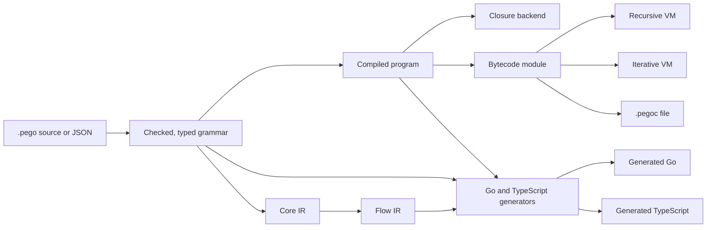

# Why PEGO

PEGO is for a Go team that needs a parser for its own DSL, configuration, query or policy language and wants typed
values, declared error recovery and incremental reparsing from one grammar, with no cgo.

- **You get** typed Go values, declared recovery, an incremental `Document`, a default depth cap, opt-in work limits
  and a TypeScript parser from one grammar, stdlib-only and tested against one engine. That breadth under one
  contract is the reason to choose PEGO.
- **Instead of** a hand-written parser, goyacc, pigeon, pointlander/peg, participle or the ANTLR Go runtime; or embed
  cel-go or Expr if an existing expression language fits ([Choosing a Tool](#choosing-a-tool)).
- **It costs** pre-release status (no tagged release; language, API and file formats may change), speed (slower than
  hand-written Go parsers), limits you must switch on, and no editor support for your language yet
  ([Current Limits](#current-limits)).

## Choosing a Tool

Choose by the job, not by the parsing algorithm. Where the table names competitors, it is checked against the versions
listed under [Sources](#sources).

| If you need | Consider | Because |
|:--|:--|:--|
| An expression, filter or policy language that CEL or Expr can already express | cel-go or Expr (`expr-lang/expr`) | No grammar to write or maintain. CEL states that it evaluates in linear time without macros, and Expr states that its programs always terminate |
| The highest throughput for one fixed format in Go | The standard library or a hand-written parser | On PEGO's benchmarks, Go's hand-written parsers are faster on every comparable workload today: 1.1–5.4× for typed values, 1.6–6.8× for trees, 8.05× for recognition and 11.5× for streaming (engine, not generated Go) |
| A small Go grammar whose types are the grammar | participle | The grammar is struct tags on your Go types, with no generated parser |
| An existing grammar for a mainstream language, or many target languages | ANTLR 4 | A large grammar library, ten runtime targets (the Go runtime is pure Go) and automatic error recovery |
| A Go parser for your own DSL, configuration, query or policy language, with typed values, declared recovery and no cgo | PEGO | One grammar gives typed Go values, `#recover`, a default depth cap and a stdlib-only parser. Work limits are opt-in: generate with `-work-controls`, then set them per call |
| The same parser in a Go backend and in a browser or Node | PEGO, ANTLR (Go, JavaScript and TypeScript targets) or tree-sitter (Go binding or gotreesitter, plus `web-tree-sitter`) | PEGO's generated Go and TypeScript need no runtime dependency and are tested against one engine. Its TypeScript has no incremental parsing or streaming, counts positions in code points or UTF-8 bytes (not UTF-16), and reaches a few hundred to a few thousand nested rule calls on Node's default stack. The repository tests run it under Node; Deno, Bun and browsers are documented but not exercised by the tests |
| A Go tool that reparses a grammar you write after small edits, on inputs that usually parse | PEGO | `Document` reuses rule results with no grammar annotations. Recovery must be declared: an unclosed construct that no `#recover` rule covers yields an error, not a tree. There is no language server for your language |
| Highlighting and structural editing for many existing languages | tree-sitter, or gotreesitter in pure Go | Hundreds of community grammars with highlight and injection queries, a tree for every input, and editors that load them |
| Language support inside CodeMirror 6 | Lezer | It is CodeMirror's parser system, with incremental parsing, recovery and step-wise parsing built for the editor |
| A TypeScript DSL with a full language server (scoping, validation, completion) | Langium | It generates the AST types and the language-server plumbing from one grammar |
| Error recovery with published quality measurements | grmtools (CPCT+) | Its repair algorithm is evaluated on 200,000 invalid Java files |
| Incremental highlighting of very large files with a PEG grammar in Go | gpeg | Edits apply in logarithmic time, and its authors' 2021 paper reports reparses of about 1 ms on 1–100 MB inputs. Captures are untyped and recovery patterns are hand-written |
| A grammar-defined format read from very large, record-shaped input | PEGO, or a streaming decoder for a fixed format | `#stream` bounds memory by the working set; a dedicated decoder such as `encoding/csv` is faster where one exists |

## What PEGO Is

PEGO is a parser framework built on Parsing Expression Grammars. Its grammar language keeps PEG's ordered choice,
greedy repetition and lookahead. It adds what plain PEG lacks: left recursion (direct and indirect), declarative
operator precedence (the Operators Rule), types and value actions, predicates with scoped variables for
context-sensitive syntax, cut, and error recovery. It is therefore PEG-based, not plain PEG
([language overview](../spec/language/overview.md)).

A `.pego` grammar is parsed, type-checked and compiled once. The compiled program runs on three engine backends in Go
or is saved as bytecode. Generated TypeScript prints the matching code of every rule from the Flow IR, and generated Go
prints its typed values and value-free rules from it; the rest of each comes from the grammar or the compiled program.

The closure backend is the default and the reference. The two bytecode VMs run saved `.pegoc` files, and the
iterative VM handles deep nesting on its own stack ([Choosing a Backend](guide/backends.md)). The Core IR and Flow IR
feed only the generators; the engine backends compile the grammar by their own routes
([intermediate representations](design/intermediate-representations.md)).

## Design Principles

Each principle is a commitment with a mechanism behind it. Where the mechanism is incomplete, the gap is stated.

**One grammar, one contract.** For the features they share, every backend returns the same trees, values, errors and
positions, within each backend's limits. The test suite compares the closure backend, both VMs, both position units,
memoization on and off, recognition against full parses, and generated Go and TypeScript against the engine
([Generated Parsers](../spec/runtime/generated-parsers.md#conformance), [development guide](development.md)). The
features each backend lacks are listed rather than approximated (see
[What One Grammar Gives You](#what-one-grammar-gives-you)).

**Performance is a design commitment.** The runtime and generators avoid allocation (slab storage for nodes, lists and
typed values, pooled frames, and typed values built without an intermediate tree). They also defer memoization for
rules whose results are never reused, drop values that recognition and discarded captures do not need, and use
specialized matching loops. The [optimization catalog](optimizations/README.md) indexes 85 mechanisms with their
backend applicability, and each mechanism has a page with its evidence. It also keeps 123 numbered records of
measured changes and lists the experiments that did not pay off. Most mechanisms have no maintained switch for
re-measuring them against the same source. The benchmark suite reruns with one command
([Performance](performance.md#how-to-measure)). [Performance](#performance) separates what is measured today from
what is targeted.

**Incremental parsing without grammar annotations.** A `Document` keeps the memo table between parses. Each memo entry
records the input range its rule examined. After an edit, entries entirely before or after the edit are kept (and
shifted), and only overlapping ones are recomputed. Every rule result is a unit of reuse, so how much an edit reuses
depends on how the grammar splits into rules and how far they look ahead
([What Incremental Parsing Reuses](guide/incremental-reuse.md)). In that guide's example, an edit in the middle of a
1,000-line list re-evaluates 3 rule bodies when the list is a repetition, but about 500 when it is right-recursive. The
specification states that a reparse returns exactly what a fresh parse of the current text returns, errors included
([Incremental Documents](../spec/runtime/documents.md)). `pego edit-fuzz` tests this: it applies random edits, undos and
redos and compares the `Document`'s values and errors with those of a fresh parse at checkpoints
([Sampling and Fuzzing](guide/sampling-and-fuzzing.md)); the repository tests run it across backends and position
units. The approach builds on incremental packrat parsing (Dubroy and Warth,
2017). gpeg extends the same idea in Go with logarithmic edit application, and tree-sitter's `fuzz` command tests its
own incremental parsing with random edits.

**Streaming with memory bounded by the working set.** When a start rule has a top-level `#stream` repetition, each
element goes to a callback and is then dropped, along with the input and memo entries before it. Memory is bounded by
the largest element, the memo entries of the last few elements, the caller's own state and the list of recovered
errors, not by the input length ([Streaming](guide/streaming.md)).

**Typed values from the grammar.** Rule types are inferred and checked when the grammar compiles. The node type is
`node[T]`. `pego gen -types` emits Go structs, `TNode[T]` values and sealed interfaces for join types, and builds them
directly during the parse when every value has a Go type. For TypeScript it emits interfaces and a `parseAST`
conversion ([Generated Typed Values](guide/generated-typed-values.md)). The engine API returns dynamic `*pego.Node`
values.

**Recovery is declared in the grammar.** `#recover(skip=e)` resumes after a broken construct and leaves an error value
in the tree, on every backend. `#missing` inserts an absent literal in whole-input parses on the closure backend
([Recovering From Errors](guide/recovery.md)). Recovery is not automatic: when no `#recover` rule covers an error,
the parse fails with no tree.

**Resource use is stated, and bounding it is the caller's choice today.** PEGO does not promise linear time.
Memoization bounds how often a rule body runs at one position. The specification states which constructs repeat work,
the classes of growth a grammar can have (linear, polynomial, exponential) with example grammars, and sufficient
conditions for linear work ([Time and Memory](../spec/runtime/parsing.md#time-and-memory)). Nesting depth is capped by
default. Work limits are opt-in today ([Cancellation and Work Limits](../spec/runtime/parsing.md#cancellation-and-work-limits)).
For a given artifact, input and options, a work limit stops a parse at the same point on every run. Context
cancellation follows the caller's clock. Limits on by default are a committed goal (see
[Commitments and Targets](#commitments-and-targets)).

**No cgo and no runtime dependencies.** The module uses only the Go standard library. Generated Go needs only the
standard library, and generated TypeScript has no dependencies. The toolchain itself runs in the browser as WebAssembly
([Playground](guide/playground.md)). The bytecode has a [published specification](../spec/bytecode/README.md); only the
Go VMs implement it today.

## What One Grammar Gives You

Status is per backend. "Engine" covers the closure backend and the two bytecode VMs. A `.pegoc` file holds one mode
(parse, recognize or document) and runs on the VMs.

| Capability | Engine (Go) | Generated Go | Generated TypeScript |
|:--|:--|:--|:--|
| Tree of nodes with positions (code points or UTF-8 bytes) | Shipped | Shipped | Shipped |
| Typed values (`node[T]`, structs, joins) | Dynamic `Node` only | Shipped (`-types`) | Shipped (`-types`, converted from the tree) |
| Recognition without a tree | Shipped | Shipped (`-recognize`) | Shipped (`-recognize`) |
| Incremental `Document` | Shipped | Partial (`-document`: no long-repetition resumption, batches or snapshots) | Not available |
| Streaming (`#stream`) | Shipped | Shipped (`-stream`) | Not available |
| Recovery with `#recover` | Shipped | Shipped | Shipped |
| Missing-literal insertion (`#missing`) | Closure whole-input parses only, opt-in; not in a `Document` | Not available | Not available |
| Nesting limit, on by default | 100,000 calls (iterative VM: 10,000,000) | 100,000 calls, `-max-depth` | 100,000 calls; on Node's default stack, a few hundred to a few thousand calls (an error, not a crash) |
| Cancellation and work limits, opt-in | Shipped | Shipped (`-work-controls`) | Shipped (`-work-controls`) |
| Tracing and profiling | Shipped | Shipped (`-observability`) | Batch parsers (`-observability`) |
| Output schema and structural queries | Go API, programmatic patterns | Not available | Not available |
| Language server, highlighting, formatter | For `.pego` grammar sources only | For your language: not available | Not available |

Around the grammar, the `pego` command offers `lint` (14 checks), `fmt`, `trace`, `profile`, `explain`, `sample`
(inputs a grammar accepts, and near misses), `edit-fuzz`, a fixture runner for grammar tests, and `lsp` for editing
`.pego` files ([Command-Line Reference](guide/command-line.md)). Ten [ready-made parsers](guide/ready-made-parsers.md)
(CEL, CSV, CUE, DuckDB SQL, Go, JSON, Python 3.14, TypeScript 5.9 and TSX, XML 1.0, YAML 1.2.2) are generated into Go
from PEGO grammars and checked against reference implementations and conformance suites. They show what the grammar
language can express and serve as large test workloads.

## Performance

Speed and memory are a core design commitment. This section separates what is measured today from what is targeted.

### Measured Today

All figures come from [Benchmark Results](benchmarks.md): commit `13b3d186`, Go 1.27.1, Apple M3 Max (darwin/arm64,
16 cores), median of three runs, positions in code points, measured on 2026-10-29. Times differ between machines.
The standard-library parsers produce different outputs (no positions, or tokens instead of a tree), so the ratios
compare different work. The JSON baseline is `encoding/json` `Unmarshal` into `any`, as built by Go 1.27.1; the report
does not record the `GOEXPERIMENT` setting, and a baseline that decodes with `encoding/json/jsontext` directly is not
measured.

| Workload | Generated Go `Parse` | Generated Go typed `ParseAST` | Go standard library | `ParseAST` ÷ standard library |
|:--|--:|--:|--:|--:|
| JSON, 262 KB | 5.67 ms | 3.89 ms | 3.50 ms (`encoding/json` into `any`) | 1.1× |
| XML, 262 KB | 6.84 ms | 5.15 ms | 3.88 ms (`encoding/xml` tokens) | 1.3× |
| CSV, 211 KB | 2.77 ms | 2.27 ms | 0.733 ms (`encoding/csv`) | 3.1× |
| Arithmetic, Operators Rule, 133 KB | 7.43 ms | 7.29 ms | 2.17 ms (`go/parser.ParseExpr`) | 3.4× |
| Arithmetic, left recursion, 133 KB | 14.7 ms | 11.8 ms | 2.18 ms (`go/parser.ParseExpr`) | 5.4× |

| Measure | Result |
|:--|:--|
| Trees: generated Go `Parse` ÷ standard library, the five workloads above ([analysis](performance.md#where-pego-stands)) | 1.62–6.76× |
| Typed values: generated Go `ParseAST` ÷ standard library, the five workloads above | 1.11–5.41× |
| Recognition: generated Go `Recognize` on JSON (2.53 ms, zero allocations) ÷ `json.Valid` (0.314 ms) | 8.05× |
| Streaming: 50,000 CSV records on the closure backend (78.5 ms) ÷ an `encoding/csv` read loop (6.82 ms) | 11.5× |
| Allocated bytes, typed `ParseAST` ÷ standard library (JSON, XML) | 1.18×, 1.25× |
| Allocations, JSON: typed `ParseAST` against `encoding/json` | 260 against 53,000 |
| Work limits on ÷ off, generated Go `Parse` (JSON and XML, generated with `-work-controls`) | 1.30–1.47× |
| Generated TypeScript `parse` under Node 24.13.0 ÷ generated Go `Parse` (seven workloads) | 2.43–4.00× |

- **Incremental.** On Minilang, a small language defined in the benchmark suite, a one-character edit and reparse of
  an 89 KB program takes 116–133 µs with `Document`. A full parse of the same program on the three engine backends
  takes 15.6–24.5 ms; generated Go is not part of that comparison.
- **Streaming memory.** In a separate measurement on a 27 MiB CSV file (Apple silicon, Go 1.27.1), `ParseStream`
  peaked at about 13 MB resident against about 1.0 GB for a whole parse ([Streaming](guide/streaming.md)).

No benchmark against another parser framework exists yet, so this page makes no speed claim relative to any tool it
compares.

### Commitments and Targets

These are goals, not results.

- **Match, then beat, hand-written parsers.** Generated Go is to reach the time of the standard-library parser on each
  comparable workload while it still returns positioned trees or typed values, and then go below it. The current
  standard-library baselines are a minimum bar for this goal, not the fastest Go parsers; the JSON comparison moves to a
  `jsontext` baseline once it is measured.
- **Work limits on by default.** Every parse gets a work budget proportional to the input length (c·n), with c
  calibrated by the complexity analysis on the repository grammars and ready-made parsers, so that ordinary grammars
  stay well below it. A grammar that the analysis does not show to be linear gets a fixed fallback budget, c·n with a
  large constant, and a lint warning. An unlimited parse has to be requested explicitly. The overhead of the limits is to shrink alongside, but the default does not wait for it.
- **One place for production limits.** Optional caps on input length and on estimated memory (memo entries and
  result trees) fail with the same kind of error as the work limit.
- **Choose the trade-off.** Generation profiles for speed, memory and size, each a named set of optimization passes,
  so a program can choose the smallest parser or the fastest one
  ([design record 063](design/records/063-configurable-optimization-pass-pipeline.md), accepted, not implemented).
- **Prove it in public.** A cross-tool benchmark with fixed workloads, stated machines and a published harness,
  starting with the Go tools that this page names as alternatives, so that any comparison can be rerun.

The [project strategy](strategy.md#performance-leadership) gives the measurable targets and the mechanisms
planned to reach them.

## Current Limits

- **Pre-release.** There is no tagged release yet; the language, the Go API and file formats (`.pegoc`, JSON forms,
  bytecode) may change between versions with no compatibility shims. The ready-made parser modules cannot be fetched
  with `go get` from another module ([Ready-Made Parsers](guide/ready-made-parsers.md)). PEGO itself requires Go 1.27.1.
- **Not safe by default for untrusted input yet.** The nesting cap is on by default; nothing else is. Default work
  limits and input-length and memory caps are committed goals ([Commitments and Targets](#commitments-and-targets)).
  - Work limits and cancellation are opt-in. Generated parsers carry them only when generated with `-work-controls`,
    which costs 1.30–1.47× on generated Go `Parse` (JSON and XML), and the three engine backends take 1.45–1.79× with
    a context or limits active ([Performance](performance.md)).
  - Both limits are needed. `MaxSteps` alone does not bound a loop that only scans input; `MaxInputWork` does.
  - The step and input-work counts are deterministic for a given artifact, input and options. Context cancellation is
    as timely as the caller's clock, and a blocked reader or callback cannot be interrupted.
  - There is no memory or input-size limit; a whole parse of 27 MiB of CSV peaked at about 1.0 GB. Work limits do not
    bound memory.
  - `pego parse` has no flag for work limits.
- **No linear-time guarantee.** Some grammars take quadratic, cubic or exponential time, and no tool classifies a
  grammar or warns about it yet ([design record 064](design/records/064-grammar-complexity.md), proposed).
- **Slower than hand-written Go parsers** on every comparable workload measured (see [Measured Today](#measured-today)).
- **Not yet editor-grade.**
  - A `Document` returns a tree only if the grammar's `#recover` rules handle each error. `#missing` is not available
    in a `Document`, so a buffer with an unclosed construct that no `#recover` rule covers gets an error, not a tree.
  - Applying an `Edit` takes time that grows with the document. At 100,000 lines, replacing one digit takes about
    0.33–0.36 ms, mostly copying the text (Apple silicon, Go 1.27.1, guide program). A length-changing edit also
    shifts the reused entries after it; that cost is not measured separately.
  - At 100,000 `key = value` lines (1.9 MiB of text), a `Document` with its tree holds 151 MiB, against 27 MiB for the
    tree alone ([Incremental Parsing Performance](guide/incremental-performance.md)).
  - `#stream` has no effect in a `Document`, and recognition-only parses cannot use one.
  - Each `Parse` returns a complete tree. Opt-in [change notifications](guide/document-changes.md) report edits and
    parse outcomes, but there is no changed-range API.
  - There is no language server, highlighting, formatter or UTF-16 position map for a language defined with PEGO; the
    language server and the VS Code extension serve `.pego` grammar sources.
- **Backend gaps.** Generated TypeScript has no streaming and no `Document`; generated Go has a `Document` subset;
  `#missing` runs only on the closure backend
  ([Compatibility and Support](../spec/runtime/generated-parsers.md#compatibility-and-support)).
- **Language gaps.** No imports or multi-file grammars; case-insensitive matching folds ASCII only.
- **Evidence base.** Benchmarks come from one machine (Apple M3 Max) and compare only with the Go standard library.
  Recovery quality is not measured.

## How PEGO Compares

Comparisons checked on 2026-10-29. Each row is checked against the tool version it names. "Not documented" means not
found in the tool's documentation and source listed under [Sources](#sources), which is weaker than "absent". The
tables describe documented behavior; they are not benchmarks.

### Parsing Model and Features

| Tool | Model | Incremental reparse | Error recovery | Streaming input | Typed output |
|:--|:--|:--|:--|:--|:--|
| PEGO (pre-release) | PEG-based, packrat memoization, left recursion, Operators Rule, predicates | No annotations; reuse depends on rule structure; result stated equal to a fresh parse and fuzz-tested (engine; generated Go subset) | Declared: `#recover` skip; `#missing` in closure whole-input parses | `#stream` elements, bounded working set | Go structs, `TNode[T]`, sealed interfaces; TypeScript interfaces |
| tree-sitter 0.27.1 | LR(1) with GLR for declared conflicts | Subtree reuse, any grammar; changed ranges; `tree-sitter fuzz` tests random edits | Automatic, grammar-independent; a tree for every input | Input read in chunks; whole tree built | Dynamic nodes; `node-types.json` for code generators |
| gotreesitter 0.56.0 | tree-sitter parse tables, pure-Go runtime | Subtree reuse; equality with fresh parses is a requirement of its v1 design plan | tree-sitter's automatic recovery; partial trees on early stops | Not documented | Typed Go structs for query matches (`cmd/tsquery`); dynamic nodes |
| Lezer (`@lezer/lr` 1.4.11) | LR with opt-in GLR | Fragment reuse, any grammar | Automatic | Chunked input; whole tree built | Untyped nodes by design |
| ANTLR 4.13.2 | ALL(*) adaptive LL, direct left recursion | No | Automatic single-token insertion and deletion, then resynchronization; pluggable | Unbuffered streams (Java runtime) | Generated context classes per rule |
| Langium 4.4.0 | LL(*) via Chevrotain | Per document (changed documents reparsed in full) | Chevrotain fault tolerance | No | Generated TypeScript AST types |
| Ohm 17.5.0 | PEG, packrat, left recursion | Memo reuse via `Matcher` (removed in the 18 beta) | Not documented | No | Untyped tree; semantics as operations, with typed action dictionaries from `@ohm-js/cli` 2.0.1 (`.d.ts`) |
| pigeon 1.3.0 | PEG to Go; memoization opt-in; left recursion behind an experimental flag | No | Labeled failures with recovery expressions | Not documented | `any` |
| participle 2.1.4 | Recursive descent from Go struct tags, at run time; experimental generated lexer | No | Partial AST up to the error | No | Your Go structs |
| gpeg (commit `d601f967`) | PEG parsing machine (LPeg-style VM), no left recursion | Any grammar; reuse where patterns are marked for memoization; logarithmic edit application | Error instruction with hand-written recovery patterns | No (random-access input) | Untyped capture nodes |
| pest 2.9.5 | PEG to Rust, no left recursion | No | Not documented | No | Untyped pairs |
| cpp-peglib 1.30.0 | PEG, packrat opt-in, left recursion | No | `%recover`, labeled failures | No | `std::any` or generic AST |
| grmtools 0.15.0 | LR(1), yacc-compatible | No | CPCT+ repair sequences | Not documented | Via actions |

### Platform and Safety

| Tool | Targets | Go and browser from one grammar | From Go without cgo | Stated worst case | Built-in resource controls | Editor tooling from the grammar |
|:--|:--|:--|:--|:--|:--|:--|
| PEGO (pre-release) | Go engine, generated Go, generated TypeScript, bytecode | Yes (generated TypeScript; no `Document` or streaming) | Yes | No polynomial bound for every grammar; classes of growth specified | Depth cap (default on); work limits and cancellation (opt-in, generated in with `-work-controls`); no memory limit | None for your language; language server for `.pego` sources |
| tree-sitter 0.27.1 | C runtime with bindings (Go, Rust, Node, Wasm and others) | Yes (Go binding and `web-tree-sitter`) | No (Go bindings use cgo) | Not documented | Progress callback for cancellation | Highlight, injection and tag queries |
| gotreesitter 0.56.0 | Go, WebAssembly | Yes (Wasm runtime) | Yes | Not documented | Deterministic work limits (iterations, stack depth, nodes), on by default with thresholds derived from the input; per-parse memory budget (on by default) and a process-heap ceiling; timeout; cancellation flag | tree-sitter queries, highlighting, tags; UTF-16 coordinates |
| Lezer 1.4.11 | JavaScript | No Go runtime | Not applicable | Not documented | Step-wise `PartialParse.advance()` and `stopAt`; the caller bounds time | CodeMirror highlighting and folding |
| ANTLR 4.13.2 | Ten targets; the tool needs Java | Yes (Go, JavaScript and TypeScript targets) | Yes (Go runtime) | O(n⁴) in theory, linear on grammars used in practice (ALL(*) paper) | Not documented | IDE plugins for `.g4` files |
| Langium 4.4.0 | TypeScript | No Go runtime | Not applicable | Not documented | Cancellation tokens | Generated language server |
| Ohm 17.5.0 | JavaScript | No Go runtime | Not applicable | Not documented | Not documented | Online grammar editor |
| pigeon 1.3.0 | Go | No | Yes | Exponential without memoization (its docs) | Expression count limit | None |
| participle 2.1.4 | Go | No | Yes | Not documented | Not documented | None |
| gpeg (`d601f967`) | Go | No | Yes | Can be super-linear where memoization is not marked (its paper) | Not documented | None |
| pest 2.9.5 | Rust | No Go runtime | Not applicable | Input size and depth limits do not bound work (its security policy) | Call limit (opt-in); native stack guard (on by default on native targets) | Online editor |
| cpp-peglib 1.30.0 | C++17 | No Go runtime | Not applicable | Exponential cases without packrat (its docs) | Depth limit, off by default | Playground, `peglint` |
| grmtools 0.15.0 | Rust | No Go runtime | Not applicable | Not documented; recovery stops at a timeout | Recovery timeout | None |

PEGO's closure backend and recursive VM use the Go stack for rule calls, and generated TypeScript uses the JavaScript
stack, which is why PEGO caps nesting depth by default; the iterative VM keeps rule calls on its own stack
([Choosing a Backend](guide/backends.md)).

**What the reader at the top of this page needs, and who covers it.** Typed values built from a grammar: ANTLR
(context classes), participle (your structs) and gotreesitter (typed query matches) cover parts of it. A parser for
Go and for the browser from one grammar: ANTLR, tree-sitter and gotreesitter. Recovery: tree-sitter, Lezer and ANTLR
recover automatically, while PEGO's is declared. Incremental reparsing in pure Go: gotreesitter and gpeg. Bounded
work: gotreesitter (on by default) and PEGO (opt-in today). PEGO's case is that one grammar covers all of these for a
language the team owns, with stdlib-only Go and dependency-free TypeScript. It is not a claim of being better at any
one of them.

**What other tools do better today.**

- tree-sitter returns a tree for every input, with ERROR and MISSING nodes and changed ranges. It also has persistent
  trees, included ranges for embedded languages and a random-edit fuzzer for every grammar author.
- gotreesitter brings 206 tree-sitter grammars to pure Go. Its deterministic work limits and per-parse memory budget
  are on by default, and it adds timeouts, UTF-16 coordinates and a Wasm runtime.
- Lezer has step-wise parsing with `stopAt`, mixed-language parsing and compact trees. ANTLR recovers automatically
  with no grammar annotations, has a large grammar library, and runs one runtime test suite against all its targets.
  Langium generates a full language server.
- gpeg applies edits in logarithmic time and has a peer-reviewed evaluation up to 100 MB. pest publishes the most
  candid resource policy of the group. pigeon offers left recursion and labeled-failure recovery in a Go PEG generator.
- Hand-written front ends such as rust-analyzer keep lossless trees that exist for every input. rust-analyzer's own
  notes say that, in practice, incremental reparsing does not matter much for IDE use and parsing from scratch is
  fast enough.

## Sources

PEGO facts are from this repository at the commit of this page. Performance figures are from
[Benchmark Results](benchmarks.md) and [Performance](performance.md). Other tools, accessed on 2026-10-29:

- tree-sitter 0.27.1: [documentation and README](https://github.com/tree-sitter/tree-sitter/tree/v0.27.1),
  [`api.h`](https://github.com/tree-sitter/tree-sitter/blob/v0.27.1/lib/include/tree_sitter/api.h),
  [`fuzz.rs`](https://github.com/tree-sitter/tree-sitter/blob/v0.27.1/crates/cli/src/fuzz.rs),
  [static node types](https://github.com/tree-sitter/tree-sitter/blob/v0.27.1/docs/src/using-parsers/6-static-node-types.md),
  [Go binding](https://github.com/tree-sitter/go-tree-sitter) (`import "C"`),
  [list of parsers](https://github.com/tree-sitter/tree-sitter/wiki/List-of-parsers)
- gotreesitter 0.56.0: [README](https://github.com/odvcencio/gotreesitter/blob/v0.56.0/README.md),
  [API guide](https://github.com/odvcencio/gotreesitter/blob/v0.56.0/docs/api-guide.md),
  [`parser_api.go`](https://github.com/odvcencio/gotreesitter/blob/v0.56.0/parser_api.go) (`ParseWorkLimits`),
  [v1 design plan](https://github.com/odvcencio/gotreesitter/blob/v0.56.0/docs/v1-design.md)
- Lezer: [guide](https://lezer.codemirror.net/docs/guide/), [reference](https://lezer.codemirror.net/docs/ref/)
  (`PartialParse`, `parseMixed`), [`lr` README](https://code.haverbeke.berlin/lezer/lr)
- ANTLR 4.13.2: [targets](https://github.com/antlr/antlr4/blob/master/doc/targets.md),
  [left recursion](https://github.com/antlr/antlr4/blob/4.13.2/doc/left-recursion.md),
  [Go runtime](https://github.com/antlr4-go/antlr) (`error_strategy.go`),
  [runtime test suite](https://github.com/antlr/antlr4/tree/4.13.2/runtime-testsuite), Parr, Harwell and Fisher,
  [Adaptive LL(*) Parsing](https://www.antlr.org/papers/allstar-techreport.pdf) (OOPSLA 2014, Theorem 6.3)
- Langium 4.4.0: [documentation](https://langium.org/docs/introduction/),
  [`DocumentBuilder`](https://github.com/eclipse-langium/langium/blob/main/packages/langium/src/workspace/document-builder.ts)
- Ohm 17.5.0: [API reference](https://github.com/ohmjs/ohm/blob/main/doc/api-reference.md),
  [`@ohm-js/cli` type generation](https://github.com/ohmjs/ohm/blob/main/packages/cli/src/helpers/generateTypes.test.js.md),
  [18.0 release notes](https://github.com/ohmjs/ohm/blob/main/doc/releases/ohm-js-18.0.md); Dubroy and Warth,
  [Incremental Packrat Parsing](https://ohmlang.github.io/pubs/sle2017/incremental-packrat-parsing.pdf) (SLE 2017)
- pigeon 1.3.0: [`doc.go`](https://github.com/mna/pigeon/blob/v1.3.0/doc.go)
- participle 2.1.4: [README](https://github.com/alecthomas/participle/blob/v2.1.4/README.md)
- gpeg: [README and source](https://github.com/zyedidia/gpeg) at commit `d601f967` (no tagged release); Yedidia and
  Chong, [Fast Incremental PEG Parsing](https://zyedidia.github.io/preprints/gpeg_sle21.pdf) (SLE 2021; AMD Ryzen 5
  1600, Go 1.16; not re-measured on the checked commit)
- pest 2.9.5: [SECURITY.md](https://github.com/pest-parser/pest/blob/master/SECURITY.md),
  [left-recursion check](https://github.com/pest-parser/pest/blob/master/meta/src/validator.rs)
- cpp-peglib 1.30.0: [README](https://github.com/yhirose/cpp-peglib)
- grmtools 0.15.0: [error recovery](https://softdevteam.github.io/grmtools/master/book/errorrecovery.html); Diekmann and
  Tratt, [Don't Panic! Better, Fewer, Syntax Errors for LR Parsers](https://arxiv.org/abs/1804.07133) (ECOOP 2020)
- cel-go 0.30.0: [README](https://github.com/google/cel-go) ("Why not JavaScript, Lua, or WASM?"); Expr 1.17.8:
  [README](https://github.com/expr-lang/expr)
- rust-analyzer: [syntax notes](https://github.com/rust-lang/rust-analyzer/blob/master/docs/book/src/contributing/syntax.md)
  ("Incremental Reparse")
